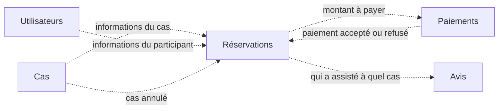

# Event_reservation

Projet du cours **NoSQL Databases** (Efrei, M1), réalisé en équipe.

Notre application permet aux utilisateurs de **rechercher et réserver des places** pour différents **cas** : concerts, matchs, spectacles… Elle permet aussi aux **organisateurs** de créer et gérer leurs cas.

L'application est découpée en **services indépendants**. Chaque service gère un seul métier et possède ses propres données. Les services se tiennent informés par des **événements** plutôt que par des appels directs, afin de rester autonomes quand l'un d'eux est indisponible.

## Vocabulaire

- **Cas** : ce que l'on réserve, c'est-à-dire un concert, un match, un spectacle…
- **Événement** : un message qu'un service envoie aux autres pour annoncer un fait (par exemple `PlacesReservees`), au sens du cours.

Nous avons choisi le mot « cas » pour ne jamais confondre ce que l'on réserve avec les événements échangés entre services.

## Équipe

| Membre | GitHub |
|---|---|
| Turpin Yane | [@Yturpin](https://github.com/Yturpin) |
| Klinger Julien | [@julienkl](https://github.com/julienkl) |
| Aboulaith Laissad | [@Ragna2024](https://github.com/Ragna2024) |
| JP Minko | [@Pierrewb02](https://github.com/Pierrewb02) |
| Jasari Anissa | [@a-jsr](https://github.com/a-jsr) |

## Les utilisateurs de l'application

- **Participant** : cherche un cas, réserve des places, paie, puis laisse un avis une fois le cas passé.
- **Organisateur** : crée ses cas, modifie leurs informations (date, prix, nombre de places) ou les annule.

## Parcours principal

1. Un organisateur crée un cas.
2. Un participant consulte les cas et réserve des places.
3. Le participant paie sa réservation, qui est alors confirmée.
4. Une fois le cas passé, le participant laisse un avis.

## Les services

| Service | Responsabilité | Données dont il est propriétaire |
|---|---|---|
| **Utilisateurs** | Inscription, profil, rôle (participant ou organisateur) | Les comptes utilisateurs |
| **Cas** | Création, modification et annulation des cas par les organisateurs | Les cas (titre, catégorie, date, lieu, prix, capacité) |
| **Réservations** | Réservation et annulation de places, suivi des places disponibles | Les réservations |
| **Paiements** | Paiement d'une réservation, remboursement en cas d'annulation | Les paiements |
| **Avis** | Notes et commentaires laissés par les participants après un cas | Les avis |

Chaque service est le **seul** à pouvoir modifier ses données. Quand un service a besoin d'une information détenue par un autre (par exemple, Réservations a besoin du prix d'un cas), il en garde une **copie locale**, mise à jour par les événements que le service propriétaire publie.



_Les flèches indiquent quelles données circulent d'un service à l'autre. Les événements exacts seront définis à l'étape 4._

## Décisions de conception

### Les places disponibles sont gérées par Réservations

Le service Cas définit la **capacité** d'un cas (le nombre total de places). Le service Réservations reçoit cette capacité et tient lui-même le compte des **places restantes**.

Pourquoi : réserver des places consiste à vérifier qu'il en reste puis à les retirer. Si ces deux opérations se font dans le même service, elles se font en une seule fois, sans risque de vendre plus de places qu'il n'en existe. Si les places restantes étaient gérées par Cas, Réservations devrait le prévenir à chaque réservation, et deux réservations simultanées pourraient se croiser.

Conséquence : si un organisateur modifie la capacité, le service Cas publie un événement que Réservations prend en compte pour recalculer les places restantes.

### Deux bases NoSQL : MongoDB et Redis

| Base | Famille | Utilisée par | Pourquoi |
|---|---|---|---|
| **MongoDB** | Document | Utilisateurs, Cas, Paiements, Avis | Ces services lisent et écrivent leurs agrégats en entier, déjà décrits en JSON. Les recherches sont variées (cas par lieu, date ou prix, avis d'un cas triés par note). Le schéma souple permet d'ajouter de nouveaux types de cas (festivals sur plusieurs jours, places numérotées, plusieurs tarifs) sans tout restructurer. |
| **Redis** | Clé-valeur | Réservations, et le transport des événements | Le moment critique d'une billetterie est l'ouverture des ventes, quand beaucoup de participants veulent les mêmes places en même temps. Redis retire les places en une seule opération atomique, ce qui empêche de vendre plus de places qu'il n'en existe. Ses listes servent aussi à faire circuler les événements entre services. |

Redis garde ses données en mémoire : sa persistance sur disque (AOF) sera activée pour ne pas perdre de réservation en cas de redémarrage.

### Ce qui est programmé

Les cinq services sont conçus en JSON. **Cas** et **Réservations** sont programmés : Cas publie ses événements, Réservations les reçoit et met à jour sa copie du cas. Les trois autres services ont leurs bases remplies et interrogeables. Les bases tournent avec Docker.

## Avancement

| Étape | Contenu | État |
|---|---|---|
| 1 | Équipe, dépôt, descriptif du projet | ✅ |
| 2 | Services et commandes associées, en JSON | ⏳ 4 services sur 5 |
| 3 | Agrégats de chaque service, en JSON | ⏳ |
| 4 | Événements entre services et agrégats répliqués, en JSON | ⏳ |
| 6 | Projection des données vers un nouveau service | ⏳ |
| Final | Implémentation | ⏳ |

## Organisation du dépôt

Les fichiers seront ajoutés au fil des étapes :

```text
services/       # étape 2 : un fichier par service, avec ses commandes
aggregates/     # étape 3 : les agrégats de chaque service
events/         # étape 4 : les événements et les agrégats répliqués
projections/    # étape 6 : la projection et sa requête
```
