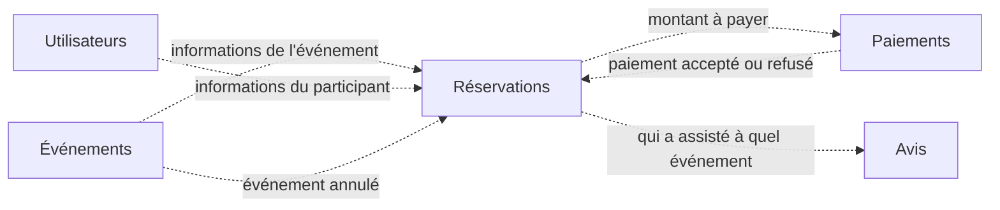

# Event_reservation

Projet du cours **NoSQL Databases** (Efrei, M1), réalisé en équipe.

Notre application permet aux utilisateurs de **rechercher et réserver des places** pour différents types d'événements (concerts, matchs, spectacles…). Elle permet aussi aux **organisateurs** de créer et gérer leurs événements.

L'application est découpée en **services indépendants**. Chaque service gère un seul métier et possède ses propres données. Les services se tiennent informés par des **événements** plutôt que par des appels directs, afin de rester autonomes quand l'un d'eux est indisponible.

## Équipe

| Membre | GitHub |
|---|---|
| Turpin Yane | [@Yturpin](https://github.com/Yturpin) |
| Klinger Julien | [@julienkl](https://github.com/julienkl) |
| Aboulaith Laissad | [@Ragna2024](https://github.com/Ragna2024) |
| JP Minko | [@Pierrewb02](https://github.com/Pierrewb02) |
| Jasari Anissa | _à venir_ |

## Les utilisateurs de l'application

- **Participant** : cherche un événement, réserve des places, paie, puis laisse un avis après l'événement.
- **Organisateur** : crée ses événements, modifie leurs informations (date, prix, nombre de places) ou les annule.

## Parcours principal

1. Un organisateur crée un événement.
2. Un participant consulte les événements et réserve des places.
3. Le participant paie sa réservation, qui est alors confirmée.
4. Après l'événement, le participant laisse un avis.

## Les services

| Service | Responsabilité | Données dont il est propriétaire |
|---|---|---|
| **Utilisateurs** | Inscription, profil, rôle (participant ou organisateur) | Les comptes utilisateurs |
| **Événements** | Création, modification et annulation des événements par les organisateurs | Les événements (titre, date, lieu, catégorie, prix, capacité) |
| **Réservations** | Réservation et annulation de places, suivi des places disponibles | Les réservations |
| **Paiements** | Paiement d'une réservation, remboursement en cas d'annulation | Les paiements |
| **Avis** | Notes et commentaires laissés par les participants après un événement | Les avis |

Chaque service est le **seul** à pouvoir modifier ses données. Quand un service a besoin d'une information détenue par un autre (par exemple, Réservations a besoin du prix d'un événement), il en garde une **copie locale**, mise à jour par les événements que le service propriétaire publie.



_Les flèches indiquent quelles données circulent d'un service à l'autre. Les événements exacts seront définis à l'étape 4._

## Décisions de conception

### Les places disponibles sont gérées par Réservations

Le service Événements définit la **capacité** d'un événement (le nombre total de places). Le service Réservations reçoit cette capacité et tient lui-même le compte des **places restantes**.

Pourquoi : réserver des places consiste à vérifier qu'il en reste puis à les retirer. Si ces deux opérations se font dans le même service, elles se font en une seule fois, sans risque de vendre plus de places qu'il n'en existe. Si les places restantes étaient gérées par Événements, Réservations devrait le prévenir à chaque réservation, et deux réservations simultanées pourraient se croiser.

Conséquence : si un organisateur modifie la capacité, Événements publie un événement que Réservations prend en compte pour recalculer les places restantes.

## Avancement

| Étape | Contenu | État |
|---|---|---|
| 1 | Équipe, dépôt, descriptif du projet | ✅ |
| 2 | Services et commandes associées, en JSON | ⏳ |
| 3 | Agrégats de chaque service, en JSON | ⏳ |
| 4 | Événements entre services et agrégats répliqués, en JSON | ⏳ |
| 6 | Projection des données vers un nouveau service | ⏳ |
| Final | Implémentation | ⏳ |

## Organisation du dépôt

Les fichiers seront ajoutés au fil des étapes :

```text
services/       # étape 2 : un fichier par service, avec ses commandes
aggregates/     # étape 3 : les agrégats de chaque service
events/         # étape 4 : les événements et les agrégats répliqués
projections/    # étape 6 : la projection et sa requête
```
